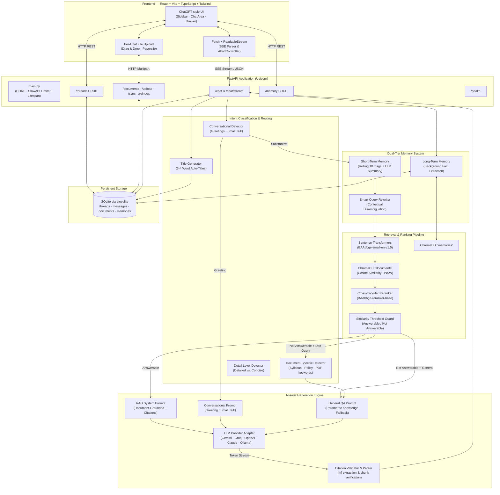

# DocuRAG — Production-Quality Grounded RAG Chatbot

DocuRAG is a production-grade, reproducible **Retrieval-Augmented Generation (RAG)** platform built over complex PDF documents (syllabi, academic policies, and research papers). It features zero-hallucination guardrails, verified inline citations, dual-tier memory (short-term + long-term), real-time SSE token streaming, ChatGPT-style sidebar with auto-generated thread titles, per-chat file upload, and intelligent fallback to parametric knowledge when answers aren't found in the knowledge base.

---

## ✨ Key Features

| Feature | Description |
|---|---|
| **ChatGPT-Style Sidebar** | Threads auto-titled with 3–4 word topic summaries (e.g., "CS101 Grading Policy"). Grouped by Today, Yesterday, Previous 7 Days, Previous 30 Days, Older. Search, rename, and delete threads. |
| **Per-Chat File Upload** | Attach PDFs directly to a conversation via paperclip button or drag-and-drop. Files are indexed in real-time and scoped to that chat via `doc_filter`. |
| **Intelligent Answer Fallback** | 3-tier answer strategy: **(1)** Answer from knowledge base with citations → **(2)** If query is document-specific but not found, list available documents → **(3)** If general question, answer from LLM's parametric knowledge. |
| **Dual-Ended Citations** | `sources_start` preview panel → inline `[n]` clickable chips → `sources_end` verified citations. Citation drawer slides in with exact page excerpts. |
| **Zero-Hallucination Guard** | Similarity threshold filter (`RETRIEVAL_SCORE_THRESHOLD`). Below-threshold queries are flagged `not_answerable` — no fabricated citations. |
| **Dual-Tier Memory** | Short-term rolling window (10 msgs + LLM summary) for follow-up context. Long-term cross-thread user fact extraction for personalization. |
| **Smart Query Rewriting** | Detects referential pronouns and context-dependent follow-ups. Rewrites queries using conversation history for accurate retrieval. |
| **Multi-Provider LLM** | Pluggable LLM engine: Gemini, Groq, OpenAI, Anthropic, and Ollama. Auto-detection of Groq API keys with model fallback chain. |
| **Real-Time SSE Streaming** | Token-by-token streaming via Server-Sent Events using `fetch` + `ReadableStream` (POST-compatible, not limited by `EventSource` GET). |
| **Dark/Light Theme** | System-aware theme toggle with localStorage persistence. |
| **Conversational Intelligence** | Greeting/small-talk detection skips retrieval pipeline. Dedicated conversational system prompt for natural responses. |
| **Auto-Sync on Startup** | Backend automatically scans `data/pdfs/` and indexes any new/modified PDFs on startup. |

---

## 🏛️ System Architecture



---

## 💡 Tech Choices & Why

| Component | Technology | Rationale |
|---|---|---|
| **Backend Framework** | FastAPI + Uvicorn | Asynchronous high-throughput, native Pydantic v2 schemas, automated OpenAPI docs. |
| **Relational DB** | SQLite via SQLAlchemy 2.0 (`aiosqlite`) | Zero operational overhead, ACID transactions, easily persisted on disk or Docker volume. |
| **Vector Store** | ChromaDB (`chromadb`) | Embedded persistent vector DB with HNSW cosine indexing. No separate cluster needed. |
| **PDF Extraction** | PyMuPDF (`fitz`) | Up to 10x faster than PDFMiner/pypdf; exact page mapping, text position coordinates, and font metadata. |
| **Embeddings** | `BAAI/bge-small-en-v1.5` | SOTA MTEB benchmark score for its parameter size; local CPU execution without API fees. Swappable to Gemini embeddings via `.env`. |
| **Reranker** | `BAAI/bge-reranker-base` | Cross-encoder reranking for improved precision. Optional — toggle via `RERANKING_ENABLED`. |
| **LLM Engine** | Gemini 2.0 Flash / Groq / OpenAI / Claude / Ollama | Pluggable interface with async generator streaming. Groq provider includes automatic model fallback chain. |
| **Frontend** | React 18 + Vite + TypeScript + Tailwind CSS | Lightning-fast HMR, strict type safety, responsive ChatGPT-style aesthetic with dark/light themes. |
| **Stream Transport** | `fetch` + `ReadableStream` | Overcomes `EventSource` limitation (GET-only); allows POST requests with rich query payloads. |
| **Rate Limiting** | SlowAPI | Configurable per-IP rate limiting (default: 20/minute). |

---

## 📁 Project Structure

```
rag-chatbot/
├── backend/
│   ├── app/
│   │   ├── api/                    # API route handlers
│   │   │   ├── chat.py             # /chat and /chat/stream endpoints
│   │   │   ├── documents.py        # /documents, /upload, /sync, /reindex
│   │   │   ├── health.py           # /health endpoint
│   │   │   ├── memory.py           # /memory CRUD endpoints
│   │   │   └── threads.py          # /threads CRUD endpoints
│   │   ├── core/                   # Core business logic
│   │   │   ├── chunking.py         # PDF text chunking with section detection
│   │   │   ├── citations.py        # Citation parsing, validation & formatting
│   │   │   ├── embeddings.py       # Embedding provider (sentence-transformers / Gemini)
│   │   │   ├── ingestion.py        # PDF ingestion pipeline (PyMuPDF → Chunk → ChromaDB)
│   │   │   ├── llm.py              # Multi-provider LLM (Gemini, Groq, OpenAI, Claude, Ollama)
│   │   │   ├── memory.py           # Short-term & long-term memory management
│   │   │   ├── prompts.py          # System prompts, intent classification, title generation
│   │   │   └── retriever.py        # Vector search, reranking, query rewriting
│   │   ├── db/                     # Database layer
│   │   │   ├── crud.py             # CRUD operations for threads, messages, documents, memories
│   │   │   ├── models.py           # SQLAlchemy ORM models
│   │   │   └── session.py          # Async session management
│   │   ├── schemas/
│   │   │   └── schemas.py          # Pydantic v2 request/response schemas
│   │   ├── config.py               # pydantic-settings configuration
│   │   └── main.py                 # FastAPI app entrypoint (CORS, limiter, lifespan)
│   └── tests/                      # Pytest test suite
│       ├── conftest.py             # Shared fixtures and mock LLM
│       ├── test_answer_modes.py    # Answer modes (Strict/Smart/Ask) & routing tests
│       ├── test_chunking.py        # Chunk metadata and page boundary tests
│       ├── test_citations.py       # Citation parsing and validation tests
│       ├── test_ingestion.py       # Ingestion idempotency tests
│       ├── test_retrieval.py       # Retrieval precision tests
│       ├── test_streaming.py       # SSE event sequence tests
│       └── test_threads.py         # Thread/message CRUD lifecycle tests
├── frontend/
│   └── src/
│       ├── api/
│       │   └── client.ts           # API client (REST + SSE streaming)
│       ├── components/
│       │   ├── ChatArea.tsx         # Main chat UI with file upload, drag & drop
│       │   ├── CitationDrawer.tsx   # Slide-in citation detail drawer
│       │   ├── DocumentsModal.tsx   # Knowledge Base document management modal
│       │   ├── MessageItem.tsx      # Individual message with citation chips
│       │   ├── SettingsModal.tsx     # Retrieval settings & memory management
│       │   ├── Sidebar.tsx          # ChatGPT-style sidebar with date grouping
│       │   └── SourcesPanel.tsx     # Sources preview panel
│       ├── hooks/
│       │   └── useChat.ts          # Chat state management hook
│       ├── types/
│       │   └── index.ts            # TypeScript type definitions
│       ├── App.tsx                  # Root component
│       ├── main.tsx                 # Vite entry point
│       └── index.css               # Global styles
├── data/
│   ├── pdfs/                       # PDF documents directory
│   ├── chroma/                     # ChromaDB persistence
│   ├── create_sample_pdfs.py       # Sample PDF generator script
│   └── rag_chatbot.db              # SQLite database
├── docker-compose.yml              # Docker Compose for backend + frontend
├── requirements.txt                # Python dependencies
├── pyproject.toml                  # Python project metadata
├── .env.example                    # Environment variable template
├── EVALUATION.md                   # Evaluation framework stub
└── Makefile                        # Development shortcuts
```

---

## 🚀 Quickstart

### Option A: Docker Compose (Recommended)

```bash
# 1. Clone and enter repo
cd rag-chatbot

# 2. Configure environment
cp .env.example .env
# Edit .env — set your GEMINI_API_KEY (or GROQ_API_KEY, OPENAI_API_KEY, etc.)

# 3. Start everything
docker compose up --build
```

- **Frontend UI**: [http://localhost:5173](http://localhost:5173)
- **Backend API & Swagger Docs**: [http://localhost:8000/docs](http://localhost:8000/docs)

---

### Option B: Local Setup (Python + Node)

#### Prerequisites
- Python 3.11+
- Node.js 18+ and npm

#### 1. Backend Setup
```bash
# In the repository root
python -m venv venv

# Windows
.\venv\Scripts\Activate
# Linux/macOS
source venv/bin/activate

# Install dependencies
pip install -r requirements.txt

# Configure environment
cp .env.example .env
# Edit .env with your API key
```

#### 2. Ingest Sample Documents
The repository includes a generator for 3 sample PDFs (`cs101_syllabus.pdf`, `academic_integrity_policy.pdf`, `deep_learning_survey.pdf`):
```bash
# Generate sample PDFs
python data/create_sample_pdfs.py

# Ingest into ChromaDB and SQLite
python -m backend.app.core.ingestion --path data/pdfs
```

> **Note:** The backend also auto-syncs any PDFs in `data/pdfs/` on startup, so manual ingestion is optional.

#### 3. Run Backend Server
```bash
uvicorn backend.app.main:app --host 0.0.0.0 --port 8000 --reload
```

#### 4. Frontend Setup & Run
```bash
cd frontend
npm install
npm run dev
```
Open [http://localhost:5173](http://localhost:5173).

---

## ⚙️ Environment Variables

All configuration is managed through `backend/app/config.py` using `pydantic-settings`. Copy `.env.example` to `.env` and customize:

| Variable | Default | Description |
|---|---|---|
| `APP_ENV` | `development` | Environment mode (`development` / `production`) |
| `DATABASE_URL` | `sqlite+aiosqlite:///./data/rag_chatbot.db` | Async SQLAlchemy database URL |
| `CHROMA_PERSIST_DIR` | `./data/chroma` | ChromaDB persistence directory |
| `EMBEDDING_PROVIDER` | `sentence-transformers` | `sentence-transformers` (local) or `gemini` |
| `EMBEDDING_MODEL` | `BAAI/bge-small-en-v1.5` | Embedding model identifier |
| `LLM_PROVIDER` | `gemini` | `gemini`, `groq`, `openai`, `anthropic`, or `ollama` |
| `LLM_MODEL` | `gemini-2.0-flash` | LLM model identifier |
| `GEMINI_API_KEY` | `""` | Google AI Studio API key |
| `GROQ_API_KEY` | `""` | Groq API key (auto-detected if starts with `gsk_`) |
| `OPENAI_API_KEY` | `""` | OpenAI API key |
| `ANTHROPIC_API_KEY` | `""` | Anthropic API key |
| `OLLAMA_BASE_URL` | `http://localhost:11434` | Ollama local server URL |
| `CHUNK_SIZE` | `800` | Target character size per text chunk |
| `CHUNK_OVERLAP` | `120` | Character overlap between adjacent chunks |
| `RETRIEVAL_TOP_K` | `8` | Number of candidate chunks retrieved |
| `RETRIEVAL_SCORE_THRESHOLD` | `0.55` | Minimum cosine similarity for answerability |
| `RERANKING_ENABLED` | `false` | Enable cross-encoder reranking |
| `RERANKING_MODEL` | `BAAI/bge-reranker-base` | Reranking model |
| `RERANKING_TOP_K` | `5` | Top-K after reranking |
| `SHORT_TERM_WINDOW` | `10` | Messages retained before rolling summarization |
| `LONG_TERM_MEMORY_ENABLED` | `true` | Extract durable user preferences across threads |
| `LONG_TERM_TOP_K` | `3` | Number of long-term memories injected into prompt |
| `RATE_LIMIT` | `20/minute` | Per-IP rate limit threshold |

---

## 📚 Ingestion & Chunking Pipeline

### CLI Ingestion
```bash
# Ingest entire directory (idempotent — skips unchanged files by SHA-256)
python -m backend.app.core.ingestion --path data/pdfs

# Force re-indexing
python -m backend.app.core.ingestion --path data/pdfs --force
```

### API Upload
Upload PDFs via the UI (Knowledge Base modal or per-chat paperclip button) or directly via API:
```bash
curl -X POST http://localhost:8000/documents/upload \
  -F "file=@path/to/document.pdf"
```

### Chunking Guarantees
- **Page-Boundary Strictness**: Chunks respect PDF page boundaries unless a section flows continuously.
- **Section Detection**: Automatically identifies chapters, units, and numbered headings to tag each chunk with section context.
- **Deterministic IDs**: Every chunk has a deterministic SHA-256 ID based on document hash, index, and content snippet.
- **Rich Metadata in ChromaDB**:
  ```json
  {
    "doc_id": "898e5a5fc6a0b4b5",
    "file_name": "cs101_syllabus.pdf",
    "page_start": 1,
    "page_end": 1,
    "section_title": "Section 2. Grading Breakdown and Criteria",
    "chunk_index": 1,
    "char_start": 340,
    "char_end": 812
  }
  ```

---

## 🎯 Citation & Guardrail Design

1. **Zero-Hallucination Grounding**: If the best retrieval cosine similarity is below `RETRIEVAL_SCORE_THRESHOLD`, the system does **not** fabricate citations. Instead, it follows the intelligent fallback strategy (see below).

2. **Double-Ended Citations**:
   - **`sources_start`**: Before the first streamed token, a panel of retrieved candidate passages (file name, page, snippet) is displayed.
   - **Inline `[n]` Chips**: As tokens stream, `[n]` markers are rendered as interactive clickable chips. Clicking opens a slide-in drawer with the exact page excerpt.
   - **`sources_end`**: After generation, unused citations are pruned — only verified citations actually referenced by the model are kept.

3. **Prompt Injection Defense**: All document text is wrapped in `<document_passage>` data fences to prevent prompt injection from uploaded content.

---

## 🧠 Intelligent Answer Fallback & Answer Modes

DocuRAG provides **3 configurable Answer Modes** that control how the system behaves when the knowledge base lacks sufficient evidence:

| Mode | Key | Behavior | Default |
|---|---|---|---|
| **Smart Fallback** | `smart_fallback` | Grounds in documents with citations. If evidence is missing, clearly notifies user and seamlessly falls back to general AI parametric knowledge. | **Yes** |
| **Ask Before Fallback** | `ask_before_fallback` | Grounds in documents when available. When missing, explains that info is not in the uploaded documents and asks user: *"Would you like me to answer using general AI knowledge?"* with interactive confirmation buttons. | Optional |
| **Strict Knowledge Base** | `strict` | Zero-hallucination mode. Only answers queries directly supported by ingested documents. If documents lack sufficient evidence, strictly refuses and suggests uploading relevant PDFs. | Optional |

### Decision & Routing Matrix

```
┌─────────────────────────────────────────────────────────────────────────────┐
│                              User Query                                     │
├──────────────────────────┬──────────────────────────────────────────────────┤
│  Conversational Query    │  → Conversational response (no retrieval)        │
│  (greeting, small talk)  │    Label: `conversational`                       │
├──────────────────────────┼──────────────────────────────────────────────────┤
│  Sufficient Evidence     │  → RAG generation with inline verified citations │
│  (retrieval >= threshold)│    Label: `knowledge_base`                       │
├──────────────────────────┼──────────────────────────────────────────────────┤
│  Partial Evidence        │  → Strict: Uses only doc context                 │
│  (some chunks relevant)  │  → Smart/Ask: Uses doc citations + general AI    │
│                          │    Label: `partial_document`                     │
├──────────────────────────┼──────────────────────────────────────────────────┤
│  Insufficient Evidence + │  → "Couldn't find in attached docs"              │
│  doc_filter active       │    Label: `insufficient_info`                    │
├──────────────────────────┼──────────────────────────────────────────────────┤
│  Insufficient Evidence + │  → Lists currently indexed documents             │
│  doc-specific question   │    Label: `insufficient_info`                    │
├──────────────────────────┼──────────────────────────────────────────────────┤
│  Insufficient Evidence + │  → Strict: Strictly refuses to answer            │
│  general question        │  → Smart Fallback: Answers with labeled AI info  │
│                          │  → Ask Fallback: Awaits user confirmation button │
│                          │    Labels: `general_ai` | `pending_fallback`     │
└──────────────────────────┴──────────────────────────────────────────────────┘
```

### Evidence Quality Classification (`EvidenceStatus`)
- **`sufficient`**: High-confidence match (top chunk exceeds score threshold and sufficient chunk support).
- **`partial`**: Borderline or single partial chunk match; answers with explicit distinction between doc sources and general knowledge.
- **`insufficient`**: Chunks missing or similarity below threshold.
- **`conflicting`**: Multiple sources contain contradictory information.
- **`retrieval_error`**: Technical issue with vector database or embedding provider.

### Visual Answer Source Indicators
Every assistant message is badged with its verified grounding source:
- 🟢 **Document Grounded**: Grounded in uploaded PDFs with inline clickable citations `[1]`, `[2]`.
- 🟡 **Partially Grounded**: Grounded in document passages supplemented with general AI knowledge.
- 🟣 **General AI Knowledge**: Parametric knowledge fallback with a dedicated notice banner.
- 🔴 **Not in Documents**: Grounding notice explaining that info wasn't found in indexed corpus.
- 🔵 **Action Required**: Interactive prompt asking user whether to proceed with general AI answer.

---

## 🧠 Memory Architecture

### Short-Term Memory (Thread-Scoped)
- Retains a rolling window of the last **N** messages (default: 10).
- When a thread exceeds N messages, older messages are summarized by the LLM into a persistent running summary stored on the `Thread` row.
- Used by `rewrite_query()` to resolve ambiguous follow-up pronouns (e.g., *"What is its deadline?"* → *"What is the deadline for CS101 assignment 1?"*).

### Smart Query Rewriting
- Detects referential words (`it`, `this`, `that`, `they`, etc.) and context-dependent phrases (`what about`, `explain more`, `continue`).
- Automatically rewrites follow-up questions into standalone queries using conversation history.
- Skips rewriting for standalone questions and conversational greetings (saves LLM roundtrips).

### Long-Term Memory (User-Scoped)
- Durable facts about the user (e.g., *"User is a 2nd-year CS student"*, *"User prefers concise bullet points"*) are extracted by an asynchronous background task.
- Deduplicated via word-level Jaccard similarity and stored in SQLite + the `memories` ChromaDB collection.
- Top-3 relevant memories are injected into the system prompt to customize tone and detail level.
- **Strict Isolation**: Long-term memories are never used as factual sources and are never cited.

---

## 💬 ChatGPT-Style Thread Management

### Auto-Generated Titles
- Thread titles are automatically generated using the LLM after the first substantive exchange.
- Titles are exactly **3–4 words** (e.g., *"CS101 Grading Policy"*, *"Binary Search Explanation"*, *"Transformer Attention Mechanism"*).
- Generic titles (e.g., *"Friendly Greeting"*, *"New Chat"*) are detected and cleaned via regex pattern matching.
- Titles update in real-time in the sidebar without requiring a page refresh.

### Sidebar Features
- **Date Grouping**: Threads organized into Today, Yesterday, Previous 7 Days, Previous 30 Days, and Older.
- **Search**: Filter conversations by title.
- **Rename**: Click the edit icon to manually rename any thread.
- **Delete**: Click the trash icon with confirmation dialog.
- **Active Highlighting**: Current thread is visually distinguished with accent color.

---

## 📎 Per-Chat File Upload

Upload PDFs directly into a specific conversation for scoped document Q&A:

- **Paperclip Button**: Click the paperclip icon in the input area to browse and select PDFs.
- **Drag & Drop**: Drag a PDF file directly onto the chat input area.
- **Status Indicators**: Real-time upload status pills showing `Indexing...`, `Ready (N chunks)`, or `Failed`.
- **Scoped Retrieval**: When files are attached, retrieval is filtered to only those documents via `doc_filter`.
- **Smart Suggestions**: When files are attached, starter prompt cards change to document-specific suggestions (summarize, extract topics, find policies).
- **Multiple Files**: Attach multiple PDFs simultaneously to cross-reference.

---

## 📡 API Reference & cURL Examples

### 1. Health Check
```bash
curl -X GET http://localhost:8000/health
```
```json
{
  "status": "ok",
  "version": "1.0.0",
  "documents_indexed": 3,
  "chroma_status": "ok (42 chunks)"
}
```

### 2. Upload Document
```bash
curl -X POST http://localhost:8000/documents/upload \
  -F "file=@data/pdfs/cs101_syllabus.pdf"
```

### 3. List Indexed Documents
```bash
curl -X GET http://localhost:8000/documents
```

### 4. Sync Documents from Disk
```bash
curl -X POST http://localhost:8000/documents/sync
```

### 5. Re-Index All Documents
```bash
curl -X POST http://localhost:8000/documents/reindex
```

### 6. Synchronous Chat (for Evaluation)
```bash
curl -X POST http://localhost:8000/chat \
  -H "Content-Type: application/json" \
  -d '{
    "query": "What is the grading breakdown in CS101?",
    "user_id": "default",
    "top_k": 5
  }'
```

### 7. Chat with Document Filter
```bash
curl -X POST http://localhost:8000/chat \
  -H "Content-Type: application/json" \
  -d '{
    "query": "Summarize the key takeaways",
    "user_id": "default",
    "doc_filter": ["cs101_syllabus.pdf"]
  }'
```

### 8. Streaming Chat via SSE
```bash
curl -N -X POST http://localhost:8000/chat/stream \
  -H "Content-Type: application/json" \
  -d '{
    "query": "What is the late penalty policy?",
    "user_id": "default"
  }'
```

**SSE Event Sequence:**
```
event: sources_start    → Candidate retrieved passages
event: token            → Streamed text deltas (repeated)
event: sources_end      → Verified citations only
event: done             → {message_id, thread_id, thread_title, latency_ms, model, not_answerable}
```

### 9. Thread Management
```bash
# List threads
curl -X GET "http://localhost:8000/threads?user_id=default"

# Create thread
curl -X POST http://localhost:8000/threads \
  -H "Content-Type: application/json" \
  -d '{"user_id": "default", "title": "Syllabus Questions"}'

# Get thread with messages
curl -X GET http://localhost:8000/threads/{thread_id}

# Rename thread
curl -X PATCH http://localhost:8000/threads/{thread_id} \
  -H "Content-Type: application/json" \
  -d '{"title": "New Title"}'

# Delete thread (cascade deletes messages)
curl -X DELETE http://localhost:8000/threads/{thread_id}
```

### 10. Long-Term Memory Management
```bash
# List user memories
curl -X GET "http://localhost:8000/memory?user_id=default"

# Delete a specific memory
curl -X DELETE http://localhost:8000/memory/{memory_id}
```

---

## 🧪 Testing

Run the automated test suite:

```bash
# From project root with venv activated
pytest backend/tests/ -v
```

Tests verify:
- ✅ Chunk metadata keys and page boundary guarantees
- ✅ Ingestion idempotency (duplicate uploads skipped by SHA-256 hash)
- ✅ Retrieval precision and correct page number return
- ✅ Citation marker parsing and validator dropping invalid indices
- ✅ Thread and message CRUD lifecycle with cascade deletion
- ✅ SSE streaming event sequence (`sources_start` → `token` → `sources_end` → `done`) with mock LLM

---

## 📊 Evaluation & Benchmarking

See [`EVALUATION.md`](./EVALUATION.md) for the evaluation framework specification. The `POST /chat` endpoint returns full telemetry for RAG evaluation:

| Field | Purpose |
|---|---|
| `answer` | Generated text response |
| `citations` | Parsed and validated citation objects with file, page, section, snippet |
| `retrieved_chunks` | All candidate chunks with cosine similarity scores |
| `latency_ms` | End-to-end processing duration |
| `not_answerable` | Boolean flag for queries below similarity threshold |
| `thread_title` | Auto-generated 3–4 word conversation title |

---

## 🔮 Roadmap & Known Limitations

- [ ] **OCR Support**: Scanned images inside PDFs currently require Tesseract OCR integration.
- [ ] **Multi-Modal Retrieval**: Visual chart and diagram extraction using multimodal vision models.
- [ ] **Hybrid BM25 + Dense Search**: Reciprocal Rank Fusion (RRF) combining sparse keyword indexing and dense embeddings.
- [ ] **Authentication**: Multi-tenant JWT authentication with organization-level access control.
- [ ] **Conversation Export**: Export chat threads as PDF or Markdown.
- [ ] **Golden Dataset Evaluation**: Automated RAG benchmark with context precision, citation faithfulness, and hallucination rate metrics.