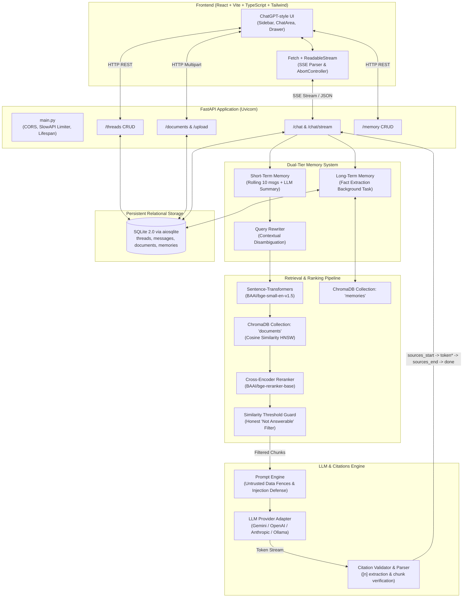

# DocuRAG — Production-Quality Grounded RAG Chatbot

DocuRAG is a production-grade, reproducible Retrieval-Augmented Generation (RAG) platform built over complex PDF documents (syllabi, academic policies, and research papers). Built with zero-hallucination guardrails, verified inline and double-ended citations, dual-tier memory (short-term rolling window and long-term cross-thread preferences), and real-time Server-Sent Events (SSE) token streaming.

---

## 🏛️ System Architecture



---

## 💡 Tech Choices & Why

| Component | Technology | Rationale |
|---|---|---|
| **Backend Framework** | FastAPI + Uvicorn | Asynchronous high-throughput, native Pydantic v2 schemas, automated OpenAPI documentation. |
| **Relational DB** | SQLite via SQLAlchemy 2.0 (`aiosqlite`) | Zero external operational overhead, rock-solid ACID transactions, easily persisted on disk or Docker volume. |
| **Vector Store** | ChromaDB (`chromadb`) | Embedded persistent vector database with HNSW cosine indexing. No separate cluster needed. |
| **PDF Extraction** | PyMuPDF (`fitz`) | Up to 10x faster than PDFMiner/pypdf; exact page mapping, text position coordinates, and font metadata. |
| **Embeddings** | `BAAI/bge-small-en-v1.5` | SOTA MTEB embedding benchmark score for its parameter size; local CPU execution without API fees. Swappable to Gemini embeddings via `.env`. |
| **LLM Engine** | Gemini 2.0 Flash / OpenAI / Claude / Ollama | Pluggable interface with async generator streaming. Default Gemini provides high speed and long context. |
| **Frontend** | React 18 + Vite + TypeScript + Tailwind CSS | Lightning-fast HMR, strict type safety, responsive ChatGPT-style aesthetic with dark/light themes. |
| **Stream Transport** | `fetch` + `ReadableStream` | Overcomes `EventSource`'s limitation (which only supports GET); allows POST requests with rich query payloads. |

---

## 🚀 Quickstart

### Option A: One Command via Docker Compose (Recommended)

Make sure Docker and Docker Compose are installed and running:

```bash
# 1. Clone and enter repo
cd rag-chatbot

# 2. Configure environment (optional: add your GEMINI_API_KEY)
cp .env.example .env

# 3. Start backend + frontend with one command
docker compose up --build
```

- **Frontend UI**: Open [http://localhost:5173](http://localhost:5173) in your browser.
- **Backend API & Swagger Docs**: Open [http://localhost:8000/docs](http://localhost:8000/docs).

---

### Option B: Local Setup (Python + Node)

#### Prerequisites
- Python 3.11+
- Node.js 18+ and npm

#### 1. Backend Setup
```bash
# In the repository root
python -m venv venv

# Windows
.\venv\Scripts\Activate
# Linux/macOS
source venv/bin/activate

# Install dependencies
pip install -r requirements.txt

# Copy environment template
cp .env.example .env
```

#### 2. Ingest Sample Documents
The repository includes a generator for 3 sample PDFs (`cs101_syllabus.pdf`, `academic_integrity_policy.pdf`, `deep_learning_survey.pdf`):
```bash
# Generate sample PDFs
python data/create_sample_pdfs.py

# Ingest into ChromaDB and SQLite
python -m backend.app.core.ingestion --path data/pdfs
```

#### 3. Run Backend Server
```bash
uvicorn backend.app.main:app --host 0.0.0.0 --port 8000 --reload
```

#### 4. Frontend Setup & Run
```bash
cd frontend
npm install
npm run dev
```
Open [http://localhost:5173](http://localhost:5173).

---

## ⚙️ Environment Variables Configuration

All configuration is managed through `backend/app/config.py` using `pydantic-settings`:

| Variable | Default Value | Description |
|---|---|---|
| `APP_ENV` | `development` | Environment mode (`development` or `production`) |
| `DATABASE_URL` | `sqlite+aiosqlite:///./data/rag_chatbot.db` | Async SQLAlchemy database URL |
| `CHROMA_PERSIST_DIR` | `./data/chroma` | Persistence directory for vector collections |
| `EMBEDDING_PROVIDER` | `sentence-transformers` | `sentence-transformers` (local) or `gemini` |
| `EMBEDDING_MODEL` | `BAAI/bge-small-en-v1.5` | Hugging Face model identifier for embeddings |
| `LLM_PROVIDER` | `gemini` | `gemini`, `openai`, `anthropic`, or `ollama` |
| `LLM_MODEL` | `gemini-2.0-flash` | LLM model identifier |
| `GEMINI_API_KEY` | `""` | Google AI Studio Gemini API Key |
| `CHUNK_SIZE` | `800` | Target character size per text chunk |
| `CHUNK_OVERLAP` | `120` | Character overlap between adjacent chunks |
| `RETRIEVAL_TOP_K` | `8` | Number of candidate chunks retrieved |
| `RETRIEVAL_SCORE_THRESHOLD` | `0.35` | Minimum cosine similarity score for answerability |
| `RERANKING_ENABLED` | `false` | Enable cross-encoder reranker (`BAAI/bge-reranker-base`) |
| `SHORT_TERM_WINDOW` | `10` | Messages retained before rolling summarization |
| `LONG_TERM_MEMORY_ENABLED` | `true` | Extract durable user preferences across threads |
| `RATE_LIMIT` | `20/minute` | Rate limiter threshold |

---

## 📚 Ingestion & Chunking Pipeline

### CLI Ingestion
```bash
# Ingest entire directory (idempotent, skips unchanged files by SHA-256)
python -m backend.app.core.ingestion --path data/pdfs

# Force re-indexing
python -m backend.app.core.ingestion --path data/pdfs --force
```

### Chunking Guarantees
- **Boundary Strictness**: Chunks strictly respect PDF page boundaries unless a section flows continuously.
- **Section Detection**: Automatically identifies chapters, units, and numbered headings to tag each chunk with section context.
- **Deterministic IDs**: Every chunk has a deterministic SHA-256 ID (`chunk_id`) based on document hash, index, and content snippet.
- **Rich Metadata in ChromaDB**:
  ```json
  {
    "doc_id": "898e5a5fc6a0b4b5",
    "file_name": "cs101_syllabus.pdf",
    "page_start": 1,
    "page_end": 1,
    "section_title": "Section 2. Grading Breakdown and Criteria",
    "chunk_index": 1,
    "char_start": 340,
    "char_end": 812
  }
  ```

---

## 🎯 Citation & Guardrail Design

1. **Zero Hallucination Grounding**: If the best retrieval cosine similarity is below `RETRIEVAL_SCORE_THRESHOLD`, the system returns:
   > *"I couldn't find this in the provided documents."*
   along with the closest related passage, and does not fabricate citations.
2. **Double-Ended Citations**:
   - **`sources_start`**: Prior to the first streamed token, a panel of retrieved candidate passages (with file name, page, and snippet) is displayed.
   - **Inline `[n]` Chips**: As tokens stream, `[n]` citations are rendered as interactive clickable chips. Clicking a chip opens a sliding side drawer displaying the exact page excerpt.
   - **`sources_end`**: After generation, unused citations are pruned, and only the verified citations actually referenced by the model are displayed in the footer.

---

## 🧠 Memory Architecture

### Short-Term Memory (Thread-Scoped)
- Retains a rolling window of the last $N$ messages (default 10).
- When a thread exceeds $N$ messages, older messages are summarized by the LLM into a persistent running summary stored on the `Thread` row.
- Used by `rewrite_query()` to resolve ambiguous follow-up pronouns (e.g., *"What is its deadline?"* $\to$ *"What is the deadline for CS101 assignment 1?"*).

### Long-Term Memory (User-Scoped)
- Durable facts about the user (e.g., *"User is a 2nd-year computer science student"*, *"User prefers concise bullet points"*) are extracted by an asynchronous background task.
- Deduplicated via word-level Jaccard similarity and stored in SQLite and the `memories` ChromaDB collection.
- Top-3 relevant memories are injected into the system prompt to customize tone and conciseness.
- **Strict Isolation**: Long-term memories are never used as factual sources for document questions and are never cited.

---

## 📡 API Reference & cURL Examples

### 1. Health Check
```bash
curl -X GET http://localhost:8000/health
```
Response:
```json
{
  "status": "ok",
  "version": "1.0.0",
  "documents_indexed": 3,
  "chroma_status": "ok (10 chunks)"
}
```

### 2. Upload Document
```bash
curl -X POST http://localhost:8000/documents/upload \
  -F "file=@data/pdfs/cs101_syllabus.pdf"
```

### 3. Synchronous Chat (Used by Evaluation Harness)
```bash
curl -X POST http://localhost:8000/chat \
  -H "Content-Type: application/json" \
  -d '{
    "query": "What is the grading breakdown in CS101?",
    "user_id": "default",
    "top_k": 5
  }'
```

### 4. Streaming Chat via Server-Sent Events (SSE)
```bash
curl -N -X POST http://localhost:8000/chat/stream \
  -H "Content-Type: application/json" \
  -d '{
    "query": "What is the late penalty policy?",
    "user_id": "default"
  }'
```

### 5. Thread Management
```bash
# List threads
curl -X GET http://localhost:8000/threads?user_id=default

# Create thread
curl -X POST http://localhost:8000/threads \
  -H "Content-Type: application/json" \
  -d '{"user_id": "default", "title": "Syllabus Questions"}'

# Delete thread
curl -X DELETE http://localhost:8000/threads/{thread_id}
```

### 6. Long-Term Memory Management
```bash
# List user memories
curl -X GET http://localhost:8000/memory?user_id=default

# Delete a memory
curl -X DELETE http://localhost:8000/memory/{memory_id}
```

---

## 🧪 Testing

Run the automated test suite with pytest:

```bash
pytest backend/tests/ -v
```

Tests verify:
- ✅ Chunk metadata keys and page boundary guarantees
- ✅ Ingestion idempotency (duplicate uploads skipped by hash)
- ✅ Retrieval precision and correct page number return
- ✅ Citation marker parsing and validator dropping invalid indices
- ✅ Thread and message CRUD lifecycle with cascade deletion
- ✅ SSE streaming events (`sources_start` $\to$ `token` $\to$ `sources_end` $\to$ `done`) with mock LLM

---

## 📊 Evaluation & Benchmarking (Phase 2 Preview)

See [`EVALUATION.md`](./EVALUATION.md) for planned golden dataset metrics and the test runner specification. `POST /chat` outputs the complete telemetry payload needed for RAG triaging (retrieved chunks, scores, citations, latency).

---

## 🔮 Roadmap & Known Limitations

- [ ] **OCR Support**: Scanned images inside PDFs currently require Tesseract OCR.
- [ ] **Multi-Modal Retrieval**: Visual chart and diagram extraction using multimodal vision models.
- [ ] **Hybrid BM25 + Dense Search**: Reciprocal Rank Fusion (RRF) combining sparse keyword indexing and dense embeddings.
- [ ] **Authentication**: Multi-tenant JWT authentication with organization-level access control.