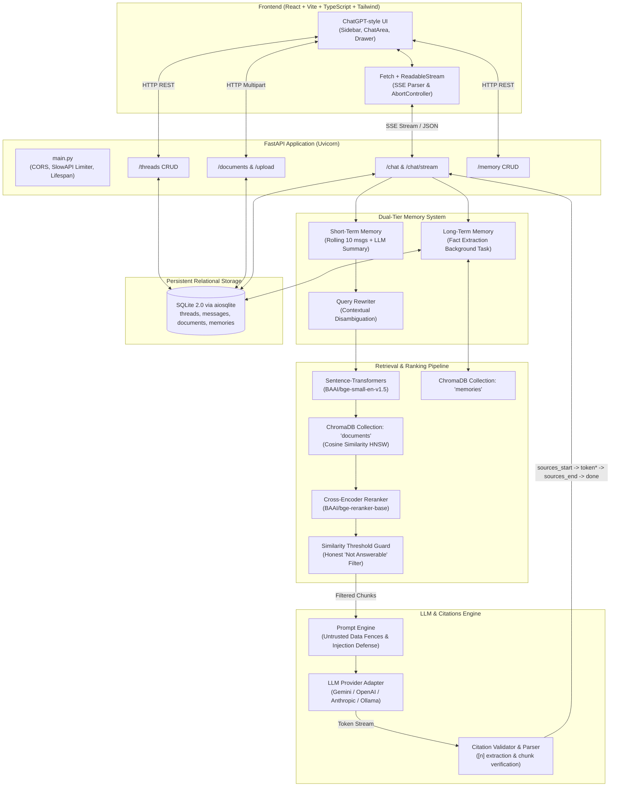

# System Architecture

## Architecture Overview

DocuRAG is an enterprise-grade, grounded Retrieval-Augmented Generation (RAG) platform designed to provide strictly factual answers over PDFs with verified inline and double-ended citations, persistent conversations, and dual-layer memory.

## Detailed Data Flows

### 1. Ingestion Pipeline
1. **Document Upload**: PDF is saved to `data/pdfs/` and a SHA-256 hash is computed.
2. **Idempotency Guard**: If the hash already matches an indexed document record, re-indexing is skipped.
3. **Extraction & Heading Detection**: PyMuPDF (`fitz`) extracts text per page and discovers section headers via regex heuristics (`Chapter`, `Unit`, `Section`, numbered headings).
4. **Recursive Chunking**: Chunks of ~800 characters with ~120 overlap are formed without crossing page boundaries.
5. **Metadata Tagging**: Each chunk is tagged with `chunk_id`, `doc_id`, `file_name`, `page_start`, `page_end`, `section_title`, `chunk_index`, and character offsets.
6. **Vector Persistence**: Vectors are computed with `BAAI/bge-small-en-v1.5` and written to ChromaDB's `documents` collection.

### 2. Retrieval & Query Rewriting
1. **Follow-Up Resolution**: Short-term memory (last 10 messages) is used to rewrite queries like *"What is the late penalty for it?"* into *"What is the late penalty for CS101 assignments?"*.
2. **Hybrid Search**: ChromaDB retrieves candidate chunks using cosine similarity.
3. **Optional Cross-Encoder Reranker**: `BAAI/bge-reranker-base` re-scores candidate pairs `(query, passage)` for high semantic precision.
4. **Answerability Guard**: If the top score falls below the configurable threshold (default `0.35`), the query is flagged as unanswerable, preventing hallucination.

### 3. Generation & Double-Ended Citations
1. **Sources Start**: Before generation begins, `sources_start` emits all candidate passages with page numbers and snippets.
2. **Token Streaming**: Tokens stream via SSE directly to the frontend.
3. **Inline Citation Chips**: Any `[n]` output is verified against retrieved chunks. Invalid or hallucinated indices are stripped.
4. **Sources End**: After generation, `sources_end` delivers the final verified citation list containing only the passages the model actually relied on.

### 4. Dual-Layer Memory
- **Short-Term Memory**: Scoped to the current thread. Stores recent messages. Once past the window limit, an LLM generates a rolling summary of older messages.
- **Long-Term Memory**: Scoped across threads to `user_id`. An asynchronous background task extracts durable preferences/facts, deduplicates them against existing memories, and stores them in SQLite and ChromaDB (`memories` collection). At query time, top-3 memories are injected into the system prompt to guide response style without being cited as factual document sources.
